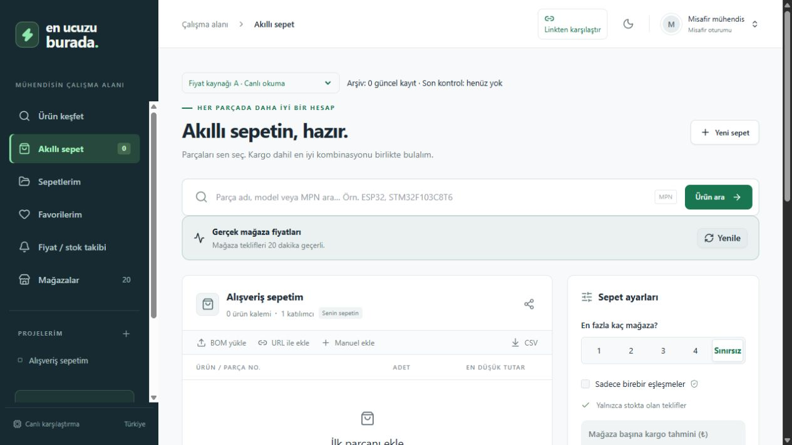
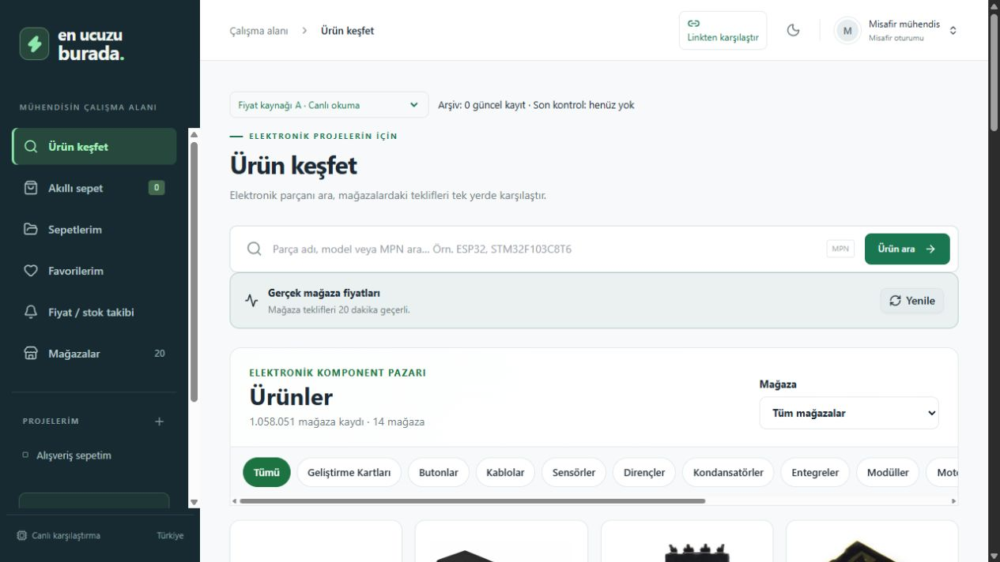
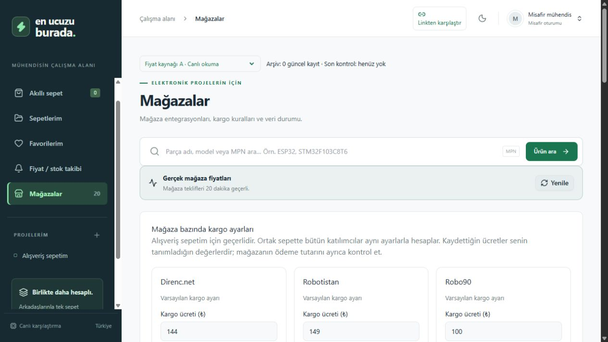
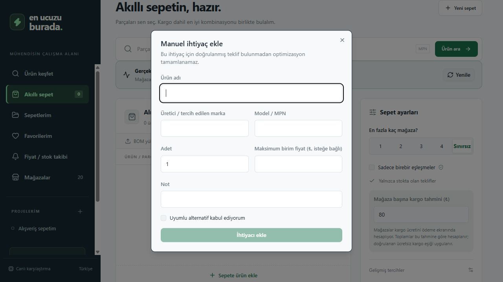

# En Ucuzu Burada

Türkiye’de elektronik komponent ve hobi elektroniği mağazalarını karşılaştıran, ürün ihtiyacından kargo dahil alışveriş planı oluşturan Türkçe web uygulaması.

Amaç, aynı parçayı farklı adlarla satan mağazaları bulmak ve bir sepeti hangi mağazalardan almanın daha ekonomik olduğunu göstermektir. Yalnız ortak model kodu aynı ürün demek değildir: CH340 entegresi, USB–TTL dönüştürücü ve CH340 kullanan geliştirme kartı ayrı ürünlerdir.

[Yayımlanan uygulama](https://en-ucuzu-burada.furkanyurtsev6.chatgpt.site/)

## Görseller

Uygulama yerelde çalıştırılarak alınan dört ekran görüntüsü.

### Akıllı alışveriş sepeti



### Ürün keşfi ve katalog



### Mağaza ve kargo ayarları



### Manuel ürün ihtiyacı ekleme




## Özellikler

- Ürün adı veya desteklenen mağazanın HTTPS ürün bağlantısıyla arama, karşılaştırma ve sepete ekleme.
- Mağazanın gerçek başlığı, kendi açıklaması ve teknik özelliklerinden ürün kimliği çıkarma; kısaltmaları ve yazım farklarını açıklamayla teyit etme.
- Model, ürün işlevi, voltaj, akım, değer, kılıf, kanal/pin sayısı ve paket farklarını koruma. Görsel benzerliği destekleyici delildir; teknik uyuşmazlığı geçersiz kılamaz.
- Mağazaya özgü okuyucularla KDV dahil fiyat, stok, minimum sipariş ve satış adımı doğrulama; son gerçek fiyatı kendi kontrol tarihiyle saklama.
- Link karşılaştırmasında yalnız ürün tutarı; sepet optimizasyonunda ürünler ve mağaza bazında kargo dahil toplam.
- Kargo bedeli ve ücretsiz kargo eşiği ayarları; aynı toplamı veren gereksiz mağaza seçeneklerini birleştirme.
- Kalıcı sepetler, miktar düzenleme, CSV/XLSX BOM içe aktarma, paylaşım rolleri ve ortak sepet değişiklikleri.
- Üyelik, favoriler, fiyat geçmişi, fiyat/stok takibi ve işlem kayıtları.
- A canlı fiyat akışı ve B tarihli fiyat arşivi arasında geçiş; kategori bazında Excel dışa aktarımı.

## Mağazalar

Direnç.net, Robotistan, Robolink Market, Robot Sepeti, SAMM Market, Motorobit, Özdisan, Robo90, Komponentci, Robiz, Robotzade, Robitshop, Robocombo ve Robotronik.

Katalog, 3 Ekim 2026 tarihli site haritalarından 1.058.051 adres içerir. **Bu sayı doğrulanmış fiyat sayısı değildir.** Okunmamış fiyat boş kalır. Her mağazanın bütün sayfalarının kesintisiz okunabildiği iddia edilmez.

## Hızlı başlangıç

Node.js >= 22.13.0 ve npm gerekir. ZIP içindeki `en-ucuzu-burada/` klasöründe:

```sh
npm ci
npm run build
```

İlk yerel veritabanına [kurulum rehberindeki](docs/KURULUM.md) **altı SQL geçişini** sırayla uygulayın. Sonra:

```sh
npm run dev
```

Adres: `http://localhost:5173`. Misafir oturumu için harici anahtar gerekmez. Paket üretim veritabanını veya kullanıcı sepetlerini içermez; temiz geliştirme ortamı oluşturur.

## A/B fiyat akışları

**A**, önce 20 dakikalık doğrulanmış kaydı kullanır; gerekli olduğunda canlı okumayı dener. **B**, önce 12 saatlik arşivi kullanır. Başarısız yeni okumada önceki fiyatın tarihi değiştirilmez. Bilinmeyen stok, stokta var diye sunulmaz; stok dışı teklif satın alma planına girmez.

B toplayıcısı SQLite kuyruğunda ilerler. Bilinen fiyatlara ve sepet bağlantılarına öncelik veren Windows komutu:

```powershell
./scripts/run-catalogue-b.ps1 -Limit 250 -KnownOnly
```

Mağaza başına en fazla 250 adres ve robots.txt bekleme aralıkları korunur. Robotzade/Robitshop için normal bilgisayar ağından okuma ve arşiv aktarımı desteklenir; yayın sunucusundaki engel her ortamda canlı erişim sağlandığı anlamına gelmez. [B arşivi rehberi](docs/B_FIYAT_ARSIVI.md).

## Teknoloji ve yapı

TypeScript, React 19, Next.js uyumlu App Router, vinext/Vite, Tailwind CSS; Cloudflare Workers ve D1/SQLite. Supabase/PostgreSQL alternatif veri katmanıdır. Para tutarları kuruş tamsayılarıyla hesaplanır.

```text
app/                   Sayfalar ve API giriş noktası
components/            Çalışma alanı, sepet ve yönetim arayüzleri
lib/                   Kimlik, fiyat, optimizasyon ve sunucu işlemleri
stores/                Mağazaya özgü okuyucular
public/catalog/        Adres dizini ve ortak eşleştirme modülleri
db/ ve drizzle/        D1 şeması ve geçişleri
supabase/migrations/   Alternatif PostgreSQL şeması
scripts/               Dizin, arşiv, doğrulama ve Excel araçları
tests/                 Testler ve tarihli mağaza parçaları
docs/                  Kurulum, mimari ve paylaşım belgeleri
```

## Kontroller

```sh
npm test
npm run typecheck
npm run build
```

4 Ekim 2026 kaynak sürümünde 175 otomatik test, tür kontrolü ve üretim derlemesi geçti. Kayıtlı 2.225 gerçek mağaza gözlemi yeniden değerlendirildi; bu, 4 Ekim’de 2.225 sayfanın yeniden okunduğu anlamına gelmez. [Sürüm notları](docs/SURUM_NOTLARI.md), [ayrıntılı rapor](VERIFICATION_2026-10-03_DESCRIPTION_EVIDENCE.md).

Ağ kullanan entegrasyon testleri ayrı yerel sunucu ister ve test sepetleri oluşturabilir. [Katkı rehberi](CONTRIBUTING.md).

## Kapsam ve sınırlar

Kargo, kullanıcı ayarı veya doğrulanmış kural yoksa tahminidir. Kuponlar, adrese/desiye özel taşıma, aynı ihtiyacın mağazalar arasında bölünmesi ve otomatik satın alma kapsam dışıdır. Arama sınırına ulaşılırsa minimumun kanıtlanmadığı belirtilir; eksik sepet optimum diye sunulmaz.

Takipler uygulama içinde gösterilir; e-posta/push teslimatı bağlı değildir. Sites üzerindeki ChatGPT üyeliği yerelde test hesabıyla temsil edilir; başka barındırma ortamına aynen taşınmış bir üyelik servisi değildir. Alternatif Supabase üyeliği ayrıca yapılandırılmalıdır.

## GitHub paylaşımı

Paket kaynak kodunu, bağımlılık kilidini, mağaza adres dizinini, testleri ve belgeleri içerir. Gerçek anahtarlar, yerel veritabanları, kullanıcı sepetleri, oturumlar, `.git`, `node_modules` ve derleme çıktıları dışarıda bırakılır. `.env.example` boş şablondur. Paketin Sites proje kimliği boş şablona çevrilir; mevcut yayın kimliği değişmez.

[GitHub rehberi](docs/GITHUB_YAYINLAMA.md) · [Mimari](docs/MIMARI.md) · [Güvenlik](SECURITY.md) · [Lisans durumu](LICENSE_NOTICE.md)

## Otomatik sürümler

[GitHub Release akışı](docs/SURUMLEME.md), main dalına gönderilen değişiklikleri test ve derlemeden sonra sürümler. İlk aktarım yerel kaynağın cc5b940117f6b9bb6a502db8862f387dad57303b commit görüntüsünden hazırlanmıştır.
