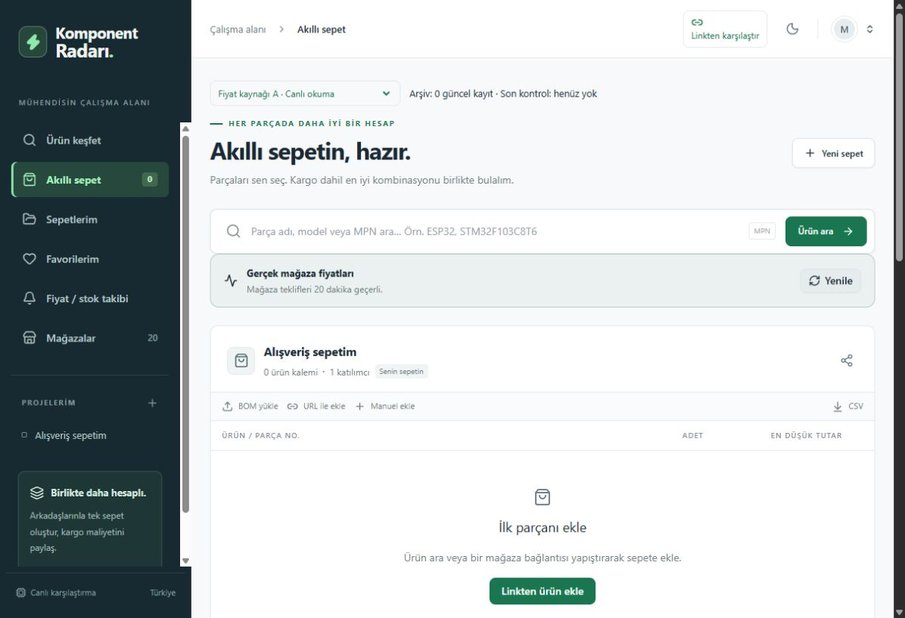
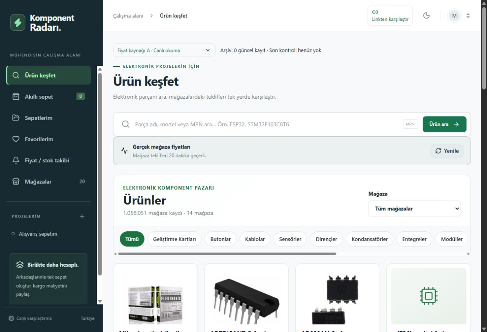
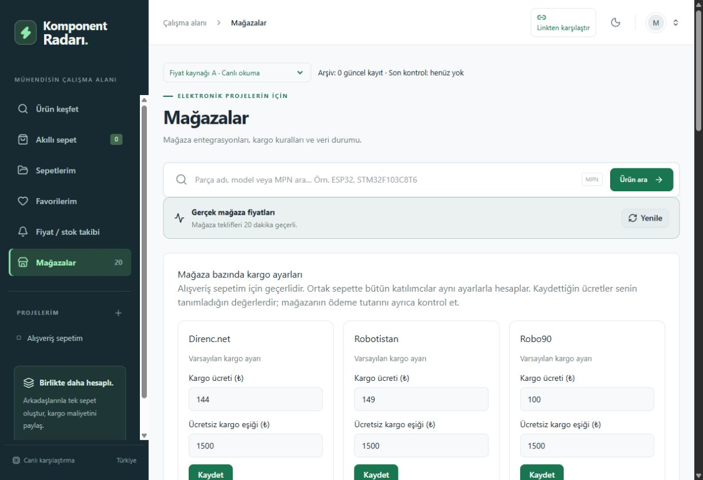
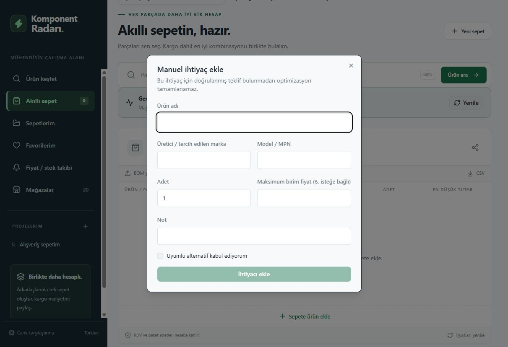

# Komponent Radarı

Türkiye’de elektronik komponent ve hobi elektroniği mağazalarını karşılaştıran, ürün ihtiyacından kargo dahil alışveriş planı oluşturan Türkçe web uygulaması.

Amaç, aynı parçayı farklı adlarla satan mağazaları bulmak ve bir sepeti hangi mağazalardan almanın daha ekonomik olduğunu göstermektir. Yalnız ortak model kodu aynı ürün demek değildir: CH340 entegresi, USB–TTL dönüştürücü ve CH340 kullanan geliştirme kartı ayrı ürünlerdir.

[Yayımlanan uygulama](https://komponent-radari.equalwood4.chatgpt.site/)

[GitHub deposu](https://github.com/furkanyrtsvr/komponent-radari)

## Görseller

Uygulama yerelde çalıştırılarak alınan dört ekran görüntüsü.

### Akıllı alışveriş sepeti



### Ürün keşfi ve katalog



### Mağaza ve kargo ayarları



### Manuel ürün ihtiyacı ekleme




## Özellikler

- Ürün adı veya desteklenen mağazanın HTTPS ürün bağlantısıyla arama, karşılaştırma ve sepete ekleme.
- Mağazanın gerçek başlığı, kendi açıklaması ve teknik özelliklerinden ürün kimliği çıkarma; kısaltmaları ve yazım farklarını açıklamayla teyit etme.
- Model, ürün işlevi, voltaj, akım, değer, kılıf, kanal/pin sayısı ve paket farklarını koruma. Görsel benzerliği destekleyici delildir; teknik uyuşmazlığı geçersiz kılamaz.
- Mağazaya özgü okuyucularla KDV dahil fiyat, stok, minimum sipariş ve satış adımı doğrulama; son gerçek fiyatı kendi kontrol tarihiyle saklama.
- Link karşılaştırmasında yalnız ürün tutarı; sepet optimizasyonunda ürünler ve mağaza bazında kargo dahil toplam.
- İlk kullanımda 20 mağaza için hazır kargo bedeli ve ücretsiz kargo eşiği; sepet bazında değiştirilebilen ayarlar; aynı toplamı veren gereksiz mağaza seçeneklerini birleştirme.
- Kalıcı sepetler, miktar düzenleme, CSV/XLSX BOM içe aktarma, paylaşım rolleri ve ortak sepet değişiklikleri.
- Üyelik, favoriler, fiyat geçmişi, fiyat/stok takibi ve işlem kayıtları.
- A canlı fiyat akışı ve B tarihli fiyat arşivi arasında geçiş; kategori bazında Excel dışa aktarımı.
- Karşılaştırma sonuçlarını seçerek hata bildirme; özel geri bildirim konuşmaları, yönetici yanıtları ve inceleme durumları. [Geri bildirim rehberi](docs/GERI_BILDIRIM.md).
- Yöneticiye tüm bildirim ve konuşmaları tek Markdown dosyasında indirme; ürün keşfet bağlamıyla hata bildirme. [Model araması ve kategori sayfalaması](docs/KATALOG_ARAMA_2026-10-23.md).

## Mağazalar

Direnç.net, Robotistan, Robolink Market, Robot Sepeti, SAMM Market, Motorobit, Özdisan, Robo90, Komponentci, Robiz, Robotzade, Robitshop, Robocombo, Robotronik, Pil Paketi, Pil Sitesi, E komponent, Ulutaş Elektronik, Hobi Devre ve F1 Depo.

Katalog, farklı tarihlerde alınmış mağaza site haritaları ve herkese açık kategori listelerinden toplam 1.159.064 adres içerir. Pil Sitesi dizini, engellenen XML site haritası nedeniyle kısmi keşiftir. **Bu sayı doğrulanmış fiyat sayısı değildir.** Okunmamış fiyat boş kalır. Her mağazanın bütün sayfalarının kesintisiz okunabildiği iddia edilmez.

## Hızlı başlangıç

Node.js 24 ve npm gerekir. Depo veya kaynak ZIP kökünde:

```sh
npm run install:ci
npm run build
```

İlk yerel veritabanına [kurulum rehberindeki](docs/KURULUM.md) **sekiz SQL geçişini** sırayla uygulayın. Sonra:

```sh
npm run dev
```

Adres: `http://localhost:5173`. Misafir oturumu için harici anahtar gerekmez. Paket üretim veritabanını veya kullanıcı sepetlerini içermez; temiz geliştirme ortamı oluşturur.

## A/B fiyat akışları

**A**, önce 20 dakikalık doğrulanmış kaydı kullanır; gerekli olduğunda canlı okumayı dener. **B**, 12 saatlik arşivi kullanır; Ürün keşfet fiyatlarını topluca yalnız ortak veritabanından okur. Eksik kayıt için canlı mağaza kontrolü başlatılmaz. Arşivden okuma önceki fiyatın tarihini değiştirmez. Bağlantıdan karşılaştırma ve sepete ekleme ayrı doğrulama akışlarıdır. Bilinmeyen stok, stokta var diye sunulmaz; stok dışı teklif satın alma planına girmez.

B toplayıcısı SQLite kuyruğunda ilerler. Bilinen fiyatlara ve sepet bağlantılarına öncelik veren Windows komutu:

```powershell
./scripts/catalog/run-catalogue-b.ps1 -Limit 250 -KnownOnly
```

Mağaza başına en fazla 250 adres ve robots.txt bekleme aralıkları korunur. Robotzade/Robitshop için normal bilgisayar ağından okuma ve arşiv aktarımı desteklenir; yayın sunucusundaki engel her ortamda canlı erişim sağlandığı anlamına gelmez. [B arşivi rehberi](docs/B_FIYAT_ARSIVI.md).

## Teknoloji ve yapı

[Belge dizini](docs/README.md) · [Bakım araçları](scripts/README.md)

TypeScript, React 19, Next.js uyumlu App Router, vinext/Vite, Tailwind CSS; Cloudflare Workers ve D1/SQLite. Supabase/PostgreSQL alternatif veri katmanıdır. Para tutarları kuruş tamsayılarıyla hesaplanır.

```text
src/                   Uygulamanın kaynak kodu
  app/                 Sayfalar ve API uçları
  components/          Arayüz bileşenleri
  hooks/               React yardımcıları
  lib/                 Fiyat, eşleştirme ve sunucu işlemleri
  stores/              Mağaza okuyucuları
  db/                  Veritabanı şeması
public/                Statik dosyalar ve mağaza adres kataloğu
scripts/               Kurulum, derleme ve bakım araçları
  catalog/             Katalog toplama, eşleştirme ve Excel araçları
  db/                  Veritabanı dönüştürme aracı
  sites/               Sites derleme entegrasyonu
tests/                 Otomatik testler ve tarihli mağaza parçaları
drizzle/               D1 / SQLite geçişleri
supabase/              Alternatif PostgreSQL geçişleri
docs/                  Kullanım ve geliştirme rehberleri
  archive/             Eski doğrulama raporları
  images/              README ekran görüntüleri
vendor/                Üçüncü taraf stil dosyası ve lisansı
```

## Kontroller

```sh
npm test
npm run typecheck
npm run build
```

4 Ekim 2026 kaynak sürümünde 175 otomatik test, tür kontrolü ve üretim derlemesi geçti. Kayıtlı 2.225 gerçek mağaza gözlemi yeniden değerlendirildi; bu, 4 Ekim’de 2.225 sayfanın yeniden okunduğu anlamına gelmez. [Sürüm notları](docs/SURUM_NOTLARI.md), [ayrıntılı rapor](docs/archive/VERIFICATION_2026-10-03_DESCRIPTION_EVIDENCE.md).

Ağ kullanan entegrasyon testleri ayrı yerel sunucu ister ve test sepetleri oluşturabilir. [Katkı rehberi](CONTRIBUTING.md).

## Kapsam ve sınırlar

Kargo, 20 mağaza için tanımlı ücret ve ücretsiz kargo eşiklerinden hesaplanır; kullanıcı bu değerleri sepetinde değiştirebilir. Kuponlar, adrese/desiye özel taşıma, aynı ihtiyacın mağazalar arasında bölünmesi ve otomatik satın alma kapsam dışıdır. Arama sınırına ulaşılırsa minimumun kanıtlanmadığı belirtilir; eksik sepet optimum diye sunulmaz.

Takipler uygulama içinde gösterilir; e-posta/push teslimatı bağlı değildir. Sites üzerindeki ChatGPT üyeliği yerelde test hesabıyla temsil edilir; başka barındırma ortamına aynen taşınmış bir üyelik servisi değildir. Alternatif Supabase üyeliği ayrıca yapılandırılmalıdır.

## GitHub paylaşımı

Paket kaynak kodunu, bağımlılık kilidini, mağaza adres dizinini, testleri ve belgeleri içerir. Gerçek anahtarlar, yerel veritabanları, kullanıcı sepetleri, oturumlar, `.git`, `node_modules` ve derleme çıktıları dışarıda bırakılır. `.env.example` boş şablondur. Paketin Sites proje kimliği boş şablona çevrilir; mevcut yayın kimliği değişmez.

[GitHub rehberi](docs/GITHUB_YAYINLAMA.md) · [Mimari](docs/MIMARI.md) · [Güvenlik](SECURITY.md) · [Lisans durumu](LICENSE_NOTICE.md)

20 Ekim 2026: 184 otomatik test; altı kategoride 84 sayfalık canlı denetim. [Mağaza kapsamı ve yayın sonrası sonuçlar](docs/STABILITE_2026-10-20.md).

20 Ekim 2026 ek entegrasyonları: Altı yeni mağaza okuyucusu ve 101.033 yeni ürün adresi. [Entegrasyon ve hata düzeltme raporu](docs/ENTEGRASYON_2026-10-20.md).

23 Ekim 2026: [Metre, paket ve Özdisan doğrulama düzeltmeleri](docs/BIRIMLER_2026-10-23.md).

23 Ekim 2026 doğruluk denetimi: 214 otomatik test; 2.500 miktar, 1.500 KDV ve 180 kapsamlı küçük sepet karşılaştırması. [Düzeltilen açıklar ve sınırlar](docs/DOGRULUK_2026-10-23.md) · [B arşivi nerede tutulur?](docs/B_FIYAT_ARSIVI.md).

23 Ekim 2026 mağaza okuyucuları: 223 test; [Robot Sepeti görünüm değişikliği, Robotistan KDV kanıtı ve sunucu erişim sınırları](docs/MAGAZA_OKUMA_2026-10-23.md).

23 Ekim 2026 toplayıcı yönlendirmesi: 235 test; [kalıcı yenileme kuyruğu, öncelik, fiyat kaynağı ve KDV güvenceleri](docs/TOPLAYICI_YONLENDIRME_2026-10-23.md).

## Otomatik sürümler

[GitHub Release akışı](docs/SURUMLEME.md), main dalına gönderilen değişiklikleri test ve derlemeden sonra sürümler. İlk aktarım yerel kaynağın cc5b940117f6b9bb6a502db8862f387dad57303b commit görüntüsünden hazırlanmıştır.

