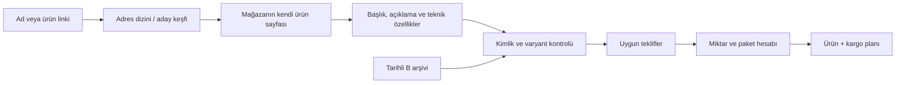

# Mimari ve ürün eşleştirmesi

Site haritası aday keşfeder. URL kelimeleri tek başına ürün/fiyat doğrulaması değildir. Görünen ürün adı mağazanın gerçek başlığıdır.

## Ortak delil katmanı

`public/catalog/product-evidence.js` bütün okuyucuların aynı ürün kaydındaki açıklama ve teknik özelliklerini işler. Kısaltılmış ad kendi açıklamasındaki başlık/girişle tamamlanabilir; model ve elektrik değerleri çelişmemelidir. Model numaraları ve sayılar bulanık yazım düzeltmesine girmez.

Tavsiye edilen ürünler, uyumluluk örnekleri ve ek model numaraları asıl ürüne dönüştürülmez. Teknik tablolardaki direnç, kapasite, indüktans, voltaj, kılıf, pin/kanal sayısı, renk, montaj ve bağlantı türü korunur. Birimler normalize edilir; 100nF ve 0,1µF eşdeğer olabilir.

`src/lib/product-role.ts` işlevi ayırır: entegre–modül, geliştirme kartı–röle/sürücü/şarj kartı, sensör–prob ve motor–sürücü farklıdır. Ortak işlemci bu ayrımı ortadan kaldırmaz.

`src/lib/catalog-identity.ts` kimlik/varyant kısıtlarını; `src/lib/cart-offers.ts` teklif ilişkilerini kontrol eder. Her teklif kendi mağaza açıklamasını kullanır; birleşmiş kayıtta başka mağazanın açıklaması yerine geçemez. Eski yanlış ilişkiler yeniden kontrol edilir.

## Fiyat ve sepet

`src/stores/` mağaza okuyucularını, `src/stores/base.ts` ortak yapılandırılmış veri işlemlerini içerir. Ana ürün, görünür fiyat, KDV, satış birimi ve teknik kimlik karşılaştırılır; öneri kartındaki ucuz fiyat kullanılmaz.

A/B aynı kimlik kurallarını paylaşır. Yeni okuma başarısızsa eski gerçek gözlemin tarihi ilerlemez. Okuma hatası, stok dışı olma ve fiyatın bilinmemesi farklı durumlardır.

`src/lib/pricing.ts` paket, minimum sipariş, satış adımı ve miktar fiyatını kuruş tamsayılarıyla hesaplar. `src/lib/optimizer.ts` mağaza kargosu/eşiği dahil plan üretir. Link ekranında ürün tutarı sıralanır; sepet ekranında kargo dahil edilir. Tam mağaza sayısı ve üst sınır farklıdır; aynı toplam tekrar gösterilmez. Eksik sepet optimum diye sunulmaz; arama sınırında minimumun kanıtlanmadığı belirtilir.

## API, oturum ve ortak sepet

`src/app/api/[...path]/route.ts` giriş; `src/lib/server/` veri, oturum, yetki, paylaşım, takip ve fiyat yenileme katmanıdır. Yetki her değişiklikte sunucuda kontrol edilir. D1 SSE ve bağlantı kontrolünü, yapılandırılmış Supabase alternatifi Realtime’ı kullanır.

Yerel fiyat arşivi kullanıcı veritabanından ayrıdır; Excel işlemi kullanıcı sepetlerini yeniden oluşturmaz. JPEG/PNG piksel benzerliği destekleyici delildir; bilinen teknik farkı aşamaz. Desteklenmeyen biçim doğrulanmış görsel sayılmaz. Bu katman nesne tanıyan bir yapay zekâ servisi değildir.
